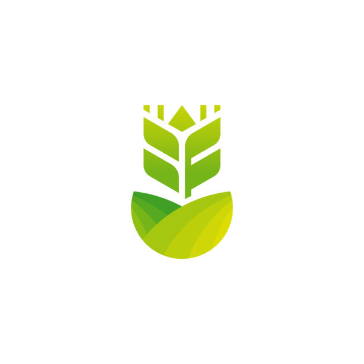

<!-- Improved compatibility of back to top link -->
<a id="readme-top"></a>

<!-- PROJECT LOGO -->
<div align="center">
  
  <h1 align="center" style="color:#4caf50; font-weight: bold;">AgriShield</h1>
  <p align="center" style="font-size:1.2em; color:#555;">
    <em>Blockchain-powered platform for agricultural insurance, carbon credits, lending, and farmer management.</em>
    <br />
    <a href="#getting-started"><strong>Get Started »</strong></a>
    <br />
  </p>
</div>

---

<!-- TABLE OF CONTENTS -->
<details open>
  <summary><b>📑 Table of Contents</b></summary>
  <ol>
    <li><a href="#about-the-project">About The Project</a></li>
    <li><a href="#built-with">Built With</a></li>
    <li><a href="#features">Features</a></li>
    <li><a href="#getting-started">Getting Started</a></li>
    <li><a href="#usage">Usage</a></li>
    <li><a href="#roadmap">Roadmap</a></li>
    <li><a href="#license">License</a></li>
  </ol>
</details>

<a id="about-the-project"></a>
## 🌱 About The Project

> **AgriChain - AgriShield** is a decentralized platform empowering farmers and stakeholders with:

- 🌦️ **Weather-triggered crop insurance**
- 🌳 **Carbon credit management**
- 🧑‍🌾 **Farmer NFT registration**
- 💸 **Lending interface(in progress)**
- 🔒 **Transparent and secure smart contracts**

The platform leverages blockchain (Ethereum/Hardhat), React, and Vite for a seamless user experience and robust backend.

<p align="right">(<a href="#readme-top">back to top</a>)</p>

<a id="built-with"></a>
## 🛠️ Built With
<p align="center">
  
  
  
  
  
  
  
</p>

<p align="right">(<a href="#readme-top">back to top</a>)</p>

<a id="features"></a>
## ✨ Features

- 🌦️ Weather-triggered insurance smart contract
- 🌳 Carbon credit tracking and trading
- 🧑‍🌾 Farmer NFT registration and management
- 💸 Lending and borrowing interface(in progress)
- 📊 Dashboard with stats, weather widget, and activity table
- 👛 Wallet connection and profile management

<p align="right">(<a href="#readme-top">back to top</a>)</p>

<a id="getting-started"></a>
## 🚀 Getting Started

Follow these steps to run the project locally.

### Prerequisites
- [Node.js](https://nodejs.org/) (v18+ recommended)
- [npm](https://www.npmjs.com/)

### Installation

```sh
# 1. Clone the repository
 git clone <your-repo-url>
 cd AgriShield

# 2. Install Backend dependencies
 cd Backend
 npm install

# 3. Install Frontend dependencies
 cd ../Frontend
 npm install

# 4-6. Start services (Windows PowerShell)
#    Open two terminals side by side

# Terminal A – start local blockchain
 cd ./Backend
 npm install
 npx hardhat node

# Terminal B – deploy contracts to localhost
 cd ./Backend
 npm run deploy:local

# Terminal C – start the frontend
 cd ./Frontend
 npm install
 npm run dev

# Vite will print the URL (e.g., http://localhost:5173 or 5174)
```

<p align="right">(<a href="#readme-top">back to top</a>)</p>

<a id="usage"></a>
## 🧑‍💻 Usage

- Connect your wallet (MetaMask) to "Localhost 8545" (chainId 31337)
  - If needed, add the network manually and optionally import Account #0 from Hardhat
  - Account #0 (prefunded) address: 0xf39F...2266 (see Hardhat node banner)
- Go to Insurance and create a policy
  - Enter a location (string) and coverage amount (wei/ETH input supported by UI)
  - Confirm the transaction in MetaMask
- Cancel current insurance
  - Use the Cancel button to call on-chain cancelPolicy() and receive a refund
- Explore other modules
  - Carbon credits, farmer NFT registration, dashboard widgets, and lending (in progress)

_For more details, see the documentation in the `Frontend/src` and `Backend/contracts` folders._

<p align="right">(<a href="#readme-top">back to top</a>)</p>

<a id="roadmap"></a>
## 🗺️ Roadmap
- [x] Weather insurance smart contract
- [x] Carbon credit module
- [x] Farmer NFT registration
- [x] Mobile responsive UI
- [ ] Lending interface
- [ ] Multi-chain support

<p align="right">(<a href="#readme-top">back to top</a>)</p>

<a id="license"></a>
## 📄 License

Distributed under the MIT License. See `LICENSE` for more information.

<p align="right">(<a href="#readme-top">back to top</a>)</p>

---

## 🔧 Chainlink Functions (AccuWeather) setup (optional)

The oracle-driven WeatherTriggeredInsurance is included for testnets. For local dev, the app uses a simple on-chain WeatherInsurance contract. To enable real weather triggers on a testnet:

1) Deploy the Chainlink contract to a testnet (e.g., Fuji/Sepolia).
2) Fund or create a Chainlink Functions subscription and note its ID.
3) Configure the contract with your AccuWeather API key and inline source:

   - In `Backend`, set environment variables and run the configure script:
     - `CONTRACT=0xYourDeployedAddress` – Address of WeatherTriggeredInsurance
     - `ACCUWEATHER_KEY=...` – Your AccuWeather API key
     - `CLF_SUBSCRIPTION_ID=...` – Optional: your Functions subscription ID
   - Then run: `npm run configure:functions`

The contract exposes helpers like `getRecommendedAccuWeatherSource()` and admin setters (`setApiKey`, `setSource`, `setSubscription`). Wire UI to this path once deployed on a live network.

